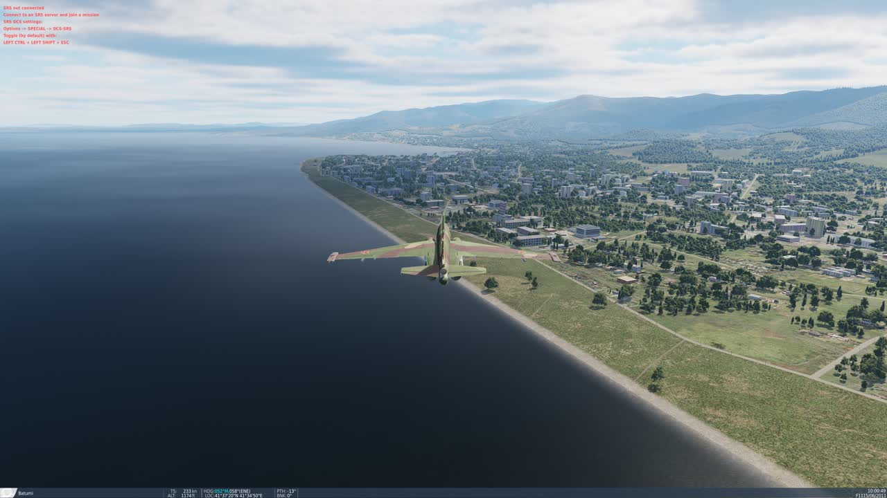

# DCS Graphics Optimizer

DCS Graphics Optimizer looks at your PC and your DCS World graphics settings, tests
them by actually running DCS, and recommends the best-looking settings your PC can
run smoothly. Nothing is changed until you press **Apply**, and **Undo** puts your old
settings back.

**Monitor (2D) only for now.** The tests and recommendations are for flying on a monitor;
VR settings are never changed. With VR switched on you get an estimated VR scorecard, and
testing inside the headset is in development (#10).

## Follow along

What's fixed and what's next is kept up to date in the pinned issue
[#26](https://github.com/Fox3Luck/DCS-Graphics-Optimizer/issues/26). Each beta has a
[milestone](https://github.com/Fox3Luck/DCS-Graphics-Optimizer/milestones?state=all), and labels show
where a report stands: **investigating**, **fix in next beta**, **fixed - please confirm**. New betas
come out at most once a day. Found a problem? [Open an issue](https://github.com/Fox3Luck/DCS-Graphics-Optimizer/issues/new).

## For players

Download `DCSGraphicsOptimizer.exe` and double-click it; there is nothing to install.
You need Windows 10 or 11, DCS World 2.9 with the free Caucasus map, DCS set to log in
automatically, and DCS closed. Until the program is code-signed, Windows shows a
"Windows protected your PC" box the first time: click **More info**, then **Run anyway**.

### The scorecard

The window opens with a summary of your hardware and three grades from A to F. DCS is
not started for this.

- **Overall** — one headline score: 40% what your PC can do, 60% how well your settings use it.
- **Your PC for DCS** — graphics card, video memory, processor (single-thread speed,
  which is what limits DCS) and memory.
- **Your current settings** — whether the frame rate holds up in the worst moments,
  whether performance is going unused that could buy better image quality, whether
  video memory is nearly full, and specific mismatches.

Before a test the settings grade is an estimate; after a test it is measured.

### The two tests and how long they take

Both tests start and close DCS by themselves, several times. Leave the PC alone until
the window says it is finished.

| | Quick test | Thorough test |
|---|---|---|
| Typical time | **10–20 minutes** | **35–60 minutes** |
| DCS starts | 2 to 5 | about 10 |
| How it decides | Measures your current settings, predicts the best combination, then tests and corrects that prediction | Also measures what each expensive setting really costs on your PC, one at a time, before deciding |
| Best for | Most people | Unusual hardware, or when the quick result does not feel right |

Measured on a fast PC with DCS on an SSD: 12 minutes for a quick test, 37 minutes for
a thorough test. Slower PCs and hard disks take longer because much of the time is
DCS loading. Close other programs that use the graphics card first; the tool refuses
to test if the card is already busy.

### What happens on every DCS start

1. Your settings file is saved and a trial version is written in its place.
2. DCS starts (about 1 minute) and loads a small test mission on the Caucasus map, as a
   private, unlisted session on your own PC.
3. About 20 seconds of waiting while textures finish loading.
4. The computer flies three scenes, about 30 seconds each, with every frame timed:
   a low pass over Batumi (**city**), the ramp at Batumi (**airfield**), and a flight
   through a cloud layer (**clouds**). No combat, nothing random.
5. DCS closes by itself and your original settings file is put back.

In the thorough test, most settings are measured inside one long DCS session that
restarts only the mission, about a minute per setting.

The goal is chosen automatically: hold your monitor's refresh rate in the worst
moments (the "1% low"), up to 120 FPS. If that would cost more than half of the
possible image quality on your PC, it aims for 90, then 72, then 60 FPS instead.

### Example result

A real thorough test on a Ryzen 7 9800X3D with an RTX 4080 at 3840 x 2160 (goal:
120 FPS in the worst moments). It took 37 minutes.

| | Before | Recommended |
|---|---|---|
| Overall score | B (80) | A (93) |
| Image quality (share of maximum) | 53% | 89% |
| Average frame rate | 260 FPS | 171 FPS |
| 1% low (worst moments) | 166 FPS | 123 FPS |

The old settings ran far above what the monitor could show with textures, shadows and
view distance turned down; the recommendation spends that spare performance on image
quality and still holds the goal. The [User Guide](docs/USER-GUIDE.md#a-worked-example)
has the full example: every setting changed, what each setting cost on that PC, and
before/after screenshots.

### What it changes, and what it never touches

It may change textures, shadows, clouds, visibility range, water, lighting effects,
filtering, forest and grass distance, civilian traffic, heat blur and the
anti-aliasing / upscaling mode. It never changes resolution, monitor setup, vertical
sync, your frame-rate cap, VR, controls, sound, gameplay or module options.

### Safety

- Your original settings are restored after every DCS start, and after a crash or an
  interrupted test the next time you open the tool.
- **Apply** keeps a dated copy of your previous settings; **Undo** restores it.
- Nothing inside the DCS installation folder is modified, and nothing is sent over
  the internet.

The full details, the list of files it creates and troubleshooting are in the
**[User Guide](docs/USER-GUIDE.md)**.

## For developers

    python -m dcstune rate              scorecard, DCS is not started
    python -m dcstune optimize [--full] benchmark + recommendation (starts DCS several times)
    python -m dcstune apply | undo
    python -m dcstune.ui                the window (Rate / Optimize / Apply / Undo)

Layout: `dcstune/optionslua.py` (byte-preserving options.lua edits, backup, crash
recovery), `sysinfo.py` (hardware + DCS discovery), `model.py` + `data/` (setting levels,
quality weights, frame-time model), `rate.py` (scorecard), `optimize.py` (search),
`bench.py` + `hook/dcstune_bench.lua` + `mission/` (benchmark), `ui.py` + `ui.html` (window).

Tests: `.venv/bin/python -m pytest tests` (needs `pytest`, `lupa`; `pydcs` only to
rebuild the mission with `mission/generate.py`).

Build the Windows app (on Windows): `powershell -ExecutionPolicy Bypass -File build\build.ps1`
produces `dist\DCSGraphicsOptimizer.exe`, a single file that needs no Python and no install.

Status 2026-11-10: scorecard, quick and thorough tests (including the no-restart
measuring session), apply and undo all verified in real DCS 2.9.31 on one PC
(RTX 4080 / 9800X3D). Not yet verified: AMD/Intel GPUs, a second PC, the packaged exe's
full click-through. The exe is signed with Azure Artifact Signing (publisher Fox3 Managed
Solutions Inc.); whether SmartScreen still warns on a fresh PC is not yet checked. VR: the scorecard recognizes the
headset and rates VR settings (an estimate); testing inside the headset is written but not yet
proven on a real headset, and stays switched off (`DCSTUNE_VR_BENCH=1` enables it for development).

## License
MIT — see [LICENSE](LICENSE).
