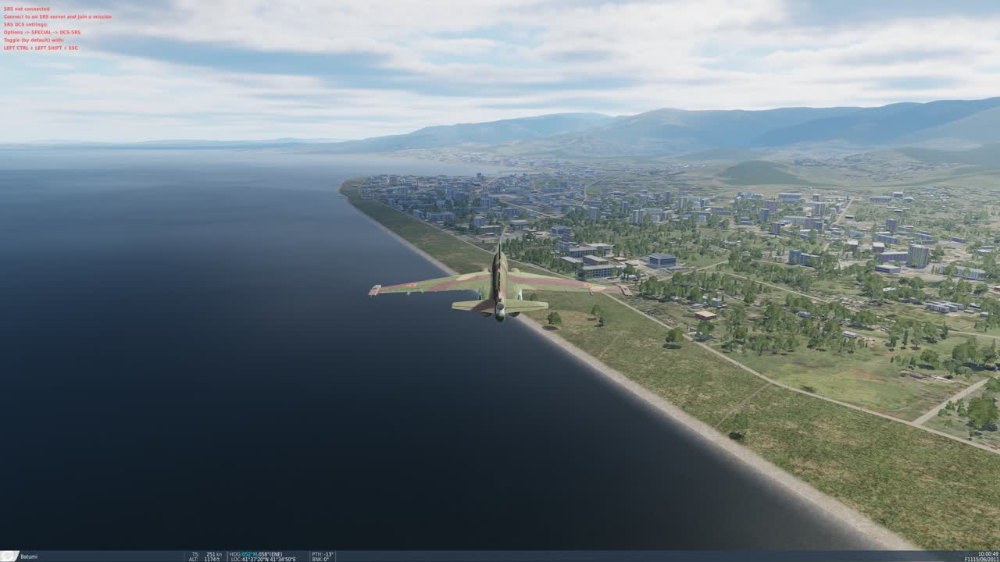
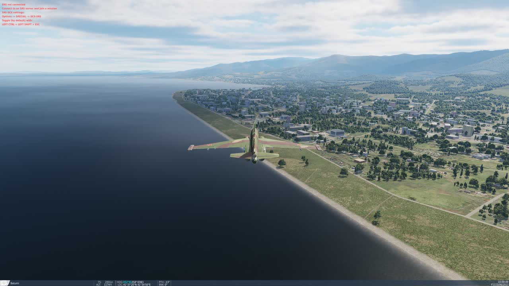

# DCS Graphics Optimizer — User Guide

DCS Graphics Optimizer looks at your PC and your DCS World graphics settings, tests
them by actually running DCS, and recommends the best-looking settings your PC can
run smoothly. Nothing is changed until you press **Apply**, and **Undo** puts your old
settings back.

- [Before you start](#before-you-start)
- [The scorecard](#the-scorecard)
- [The two tests and how long they take](#the-two-tests-and-how-long-they-take)
- [What happens during a test](#what-happens-during-a-test)
- [What is measured](#what-is-measured)
- [The result](#the-result)
- [A worked example](#a-worked-example)
- [What the tool changes, and what it never touches](#what-the-tool-changes-and-what-it-never-touches)
- [Safety](#safety)
- [Files it creates](#files-it-creates)
- [If something goes wrong](#if-something-goes-wrong)
- [Current limits](#current-limits)

## Before you start

You need:

- Windows 10 or 11.
- DCS World 2.9 with the free **Caucasus** map installed (it comes with DCS). No paid
  modules are needed; the test uses the free Su-25T flown by the computer.
- DCS set to log in automatically (the default once you have logged in and ticked
  "remember me"). If DCS stops at a login box, the test cannot continue.
- **DCS closed.** The tool refuses to start a test while DCS is running.
- **Nothing else using the graphics card.** Close other games, video renders, AI image
  or speech tools and browser videos. The tool checks before it starts and refuses to
  test if the graphics card is already busy, because the results would be wrong.

Download `DCSGraphicsOptimizer.exe` and double-click it. There is nothing to install.
Until the program is code-signed, Windows shows a blue "Windows protected your PC"
box the first time: click **More info**, then **Run anyway**.

## The scorecard

The window opens with a summary of your hardware (graphics card, video memory,
processor, memory, display, DCS drive and DCS version) and three grades, each from
A to F. DCS is **not** started for this.

**Overall** is one headline score: 40% what your PC can do and 60% how well your
settings use it. After a test, the result shows how the overall score would change.

**Your PC for DCS** rates the hardware: graphics card, video memory, processor and
memory. The processor is judged on single-thread speed, because that is what limits
DCS. This grade comes from a built-in table of hardware.

**Your current settings** rates how well your DCS settings fit that PC. It looks at:

- whether the frame rate holds up in the worst moments,
- whether performance is being left unused that could buy better image quality,
- whether video memory is close to full (a common cause of stutter),
- specific mismatches, for example low textures on a card with plenty of video memory.

Before you have run a test this grade is an **estimate**. After a test it is labelled
**measured**, and later visits use what the test learned about your PC
("estimated from your last test").

## The two tests and how long they take

Both tests start and close DCS by themselves, several times. **Leave the PC alone
until the window says it is finished**: moving the mouse into DCS, alt-tabbing, or
running other heavy programs changes the results.

| | Quick test | Thorough test |
|---|---|---|
| Button | Test and optimize | Thorough test |
| Typical time | **10–20 minutes** | **35–60 minutes** |
| DCS starts | 2 to 5 | about 10 |
| How it decides | Measures your current settings, predicts the best combination from built-in knowledge of what each setting costs, then tests that prediction and corrects it | Also measures what the expensive settings really cost **on your PC**, one at a time, before deciding |
| Best for | Most people | Unusual hardware, or when the quick result does not feel right |

Measured on a fast PC with DCS on an SSD (Ryzen 7 9800X3D, RTX 4080): a quick test of
four DCS starts took 12 minutes, and a thorough test took 37 minutes. A single DCS
start-to-finish measurement takes about 2.5 minutes there. Slower PCs, and DCS
installed on a hard disk, take longer because much of that time is DCS loading.

These times come from testing on one PC so far and will be refined.

## What happens during a test

For every DCS start, the same thing happens:

1. **Your settings file is saved** and a trial version is written in its place.
2. **DCS starts** (about 1 minute) and loads a small test mission on the Caucasus map.
   You will see DCS open on its own. Technically DCS hosts the mission as a private,
   unlisted, password-protected session on your own PC; nobody can see or join it.
3. **About 20 seconds of waiting** while textures finish loading, so loading does not
   pollute the measurement.
4. **Three scenes are flown by the computer**, each watched from a camera behind the
   aircraft, about 30 seconds each (about 12 seconds each for the shorter
   measurements in the thorough test):
   - **City** — a low pass along the coast over Batumi: buildings, trees and water.
   - **Airfield** — parked aircraft on the ramp at Batumi: detailed models and shadows.
   - **Clouds** — flying through a broken cloud layer.

   There is no combat and nothing random, so every run sees the same thing.
5. **Every frame is timed.** One screenshot is taken per scene.
6. **DCS closes by itself** and your original settings file is put back.

The quick test does this for your current settings, then for its recommendation, and
repeats with a corrected recommendation if the first one missed the goal.

The thorough test adds a measuring phase before that. It measures each expensive
setting at its lowest and highest level (shadows, clouds, visibility range, water,
ambient occlusion and so on), one change at a time:

- **Most settings are measured inside one long DCS session.** DCS stays open; the tool
  changes one setting, restarts only the mission (about a minute per setting) and
  flies the three scenes again in a shorter form. You will see the mission reload
  again and again; that is normal. The session begins with a warm-up that is thrown
  away, and it begins and ends with your own settings: if those two readings
  disagree, something else was using the PC and the whole session's numbers are
  discarded.
- **Textures and terrain textures get a DCS start each**, because DCS only applies
  them properly after a restart or a long reload.
- A few settings that cost almost nothing (anisotropic filtering, civilian traffic,
  heat blur, volumetric lights, cockpit lighting) are not measured one by one.

Then it searches and confirms as the quick test does. If one DCS start fails, the
test retries or skips that measurement and carries on. If measurements had to be
discarded, the result says so and suggests running the test again with other
programs closed.

## What is measured

- **Average frame rate** in each scene.
- **1% low** — the frame rate your PC holds 99% of the time. This is the number that
  decides whether DCS *feels* smooth, and it is the one the goal is set on.
- **Stutters** — single frames that took much longer than normal.
- **Video memory** in use on the graphics card at the peak (this includes whatever
  other programs are using).

During a test, vertical sync and the frame-rate cap are switched off so the numbers
show what the PC can really do. Your own choices for both come back afterwards.

**The goal is chosen automatically:** hold your monitor's refresh rate in the worst
moments, up to 120 FPS. If reaching that would cost more than half of the possible
image quality on your PC, the tool aims for 90, then 72, then 60 FPS instead, and
tells you so.

## The result

After a test the window shows:

- the grade change, for example **B → A**,
- two measured scorecards side by side: **Before** and **Recommended**, each with its
  frame rates and video memory,
- a table of every setting that would change, with its current and recommended value.

If your settings are already the best match, it says so and offers nothing to apply.
If your PC cannot reach even the lowest goal, it recommends the smoothest result it
measured and says the goal was not reached.

Press **Apply these settings** to use the recommendation (DCS must be closed). Press
**Undo last change** at any later time to go back.

A change is only recommended when it is clearly better looking and still holds the
goal. The tool never recommends something that measured worse than what you have.

## A worked example

A real thorough test, run on 10 November 2026 with nothing else using the PC.

**The PC:** Ryzen 7 9800X3D, GeForce RTX 4080 (16 GB), 62 GB memory, DCS 2.9.31,
rendering at 3840 x 2160 with DLSS on a 143 Hz monitor. The goal was therefore
120 FPS in the worst moments.

**The test:** 37 minutes, 10 DCS starts. One of those starts was the long session
that measured 16 setting changes without restarting DCS (17 minutes).

**The result:**

| | Before | Recommended |
|---|---|---|
| Overall score | B (80) | A (93) |
| Settings grade | B (72) | A (94) |
| Image quality (share of maximum) | 53% | 89% |
| Average frame rate | 260 FPS | 171 FPS |
| 1% low (worst moments) | 166 FPS | 123 FPS |
| Video memory at peak | 6.3 GB | 7.9 GB |

The "before" settings were leaving performance unused: they ran far above what the
monitor can show while textures, shadows and view distance were turned down. The
recommendation spends that spare performance on image quality and still holds the
goal.

Per scene (average / 1% low, in FPS):

| Scene | Before | Recommended |
|---|---|---|
| City | 274 / 204 | 181 / 144 |
| Airfield | 280 / 216 | 178 / 144 |
| Clouds | 225 / 166 | 155 / 123 |

**What it changed:**

| Setting | Before | Recommended |
|---|---|---|
| Upscaling | DLSS Balanced | DLSS Quality |
| Textures | Medium | High |
| Terrain textures | Low | High |
| Shadows | Medium | High |
| Terrain object shadows | Flat | Default |
| Visibility range | Medium | Extreme |
| Forest distance | 50% | 100% |
| Grass / clutter distance | 750 m | 1500 m |
| Anisotropic filtering | 2x | 16x |
| Screen-space reflections | Off | On |
| Screen-space shadows | Off | On |
| Cockpit global illumination | Off | On |
| Civilian traffic | Low | High |
| Heat blur | Off | Low |

It left clouds on Ultra, and deliberately left ambient occlusion off and water on
Medium, because the measurements below showed those are the most expensive settings
on this PC for what they add.

**What each setting cost on this PC** (extra frame time at its highest level compared
with its lowest):

| Setting at its highest level | Cost |
|---|---|
| Ambient occlusion (High) | 14.7% |
| Clouds (Ultra) | 9.9% |
| Water (High) | 8.2% |
| Visibility range (Extreme) | 6.6% |
| Terrain object shadows (Default) | 5.4% |
| Shadows (High) | 4.2% |
| Screen-space shadows (On) | 3.9% |
| Grass / clutter distance (1500 m) | 2.4% |
| Screen-space reflections (On) | 2.3% |
| Terrain textures (High) | 1.8% |
| Forest distance (100%) | 1.8% |
| Textures (High) | 0.4% |

Repeated measurements of the same settings differ by about 1–2%, so the bottom of this
table is within measuring noise. These costs belong to this PC, this resolution and
these scenes; yours will differ, which is the reason to measure.

The same moment of the city scene, before and after:

## What the tool changes, and what it never touches

It may change: textures, terrain textures, shadows, terrain object shadows, clouds,
visibility range, water, ambient occlusion, screen-space reflections and shadows,
cockpit lighting, anisotropic filtering, volumetric lights, forest and grass
distance, civilian traffic, heat blur, and the anti-aliasing / upscaling mode
(DLAA, DLSS, MSAA, TAA, FSR).

It never changes: resolution, monitor setup, full-screen mode, vertical sync, your
frame-rate cap, field of view, gamma, colour grading, lens effects, motion blur,
VR settings, controls, sound, gameplay or module options.

## Safety

- Your original settings are restored after **every** DCS start during a test.
- If the PC crashes, DCS hangs, or you close the tool mid-test, your original settings
  are restored the next time you open the tool. A DCS start that takes longer than
  10 minutes is closed automatically.
- **Apply** keeps a dated copy of your previous settings; **Undo** restores it.
- Nothing inside the DCS installation folder is modified, so DCS's file check stays
  clean and multiplayer is unaffected.
- The tool never runs while you are flying and does nothing in multiplayer.
- Nothing is sent over the internet. All results stay on your PC.

## Files it creates

All inside your `Saved Games\DCS` (or `DCS.openbeta`) folder.

Only while a test is running, removed afterwards:

- `Scripts\Hooks\dcstune_bench.lua` — the script that flies the camera and times frames
- `Missions\dcstune_bench.miz` — the test mission
- `Config\dcstune_directive.json`, `Config\dcstune_result.json`
- `Config\options.lua.dcstune-original`, `Config\dcstune-journal.json` — your saved
  settings and the note that lets them be restored after a crash

Kept:

- `Config\dcstune-report.json` — the last recommendation, until you apply it
- `Config\dcstune-calibration.json` — what the last test learned about your PC
- `Config\options.lua.dcstune-bak-<date>-<time>` — your settings from before each Apply
- `ScreenShots\dcstune_…` — the before and recommended screenshots from the last test
- `Config\dcstune-last-failure.log` — a copy of DCS's log, only if a test run failed

To remove every trace, delete the files starting with `dcstune` and
`options.lua.dcstune` from those folders.

## If something goes wrong

| What you see | What to do |
|---|---|
| "DCS is running. Close it first" | Close DCS completely, then try again. |
| DCS opens and sits at a login box | Log in once in DCS with auto-login on, close DCS, run the test again. |
| "Another program is using your graphics card" | Close other games, video renders, AI tools and browser videos, then try again. |
| "Another program was using the PC during part of this test" | The result is still safe to use, but some measurements were discarded. For the best result, close other programs and run the test again. |
| "DCS closed without writing a benchmark result" | DCS crashed or was closed. A copy of its log is saved as `Config\dcstune-last-failure.log`. Start DCS normally once, then try again. |
| "DCS did not finish the benchmark in time" | Start DCS normally once to check it reaches the main menu (an update or a first-time shader build may be pending), then try again. |
| "An earlier test was interrupted. Your original settings have been restored." | Nothing to do; this is the safety net working. |
| The window shows the wrong DCS profile | The tool uses the profile your DCS install uses. Other profiles are listed in `Saved Games`; profile choice in the window is not available yet. |
| DCS feels worse after Apply | Press **Undo last change**. |

Details of each run are written to `Saved Games\DCS\Logs\dcs.log` on lines containing
`DCSTUNE`.

## Current limits

- Flat-screen only. If VR is switched on, the tool says so and leaves VR settings
  alone; VR tuning is planned for the next version.
- Tested so far on one PC with an NVIDIA card. AMD and Intel graphics cards are
  supported in the code but not yet tested.
- The image-quality scores behind the recommendation are a judgement of what each
  setting adds visually. If you care more about one thing (for example long
  visibility for spotting), adjust that setting yourself after applying.
